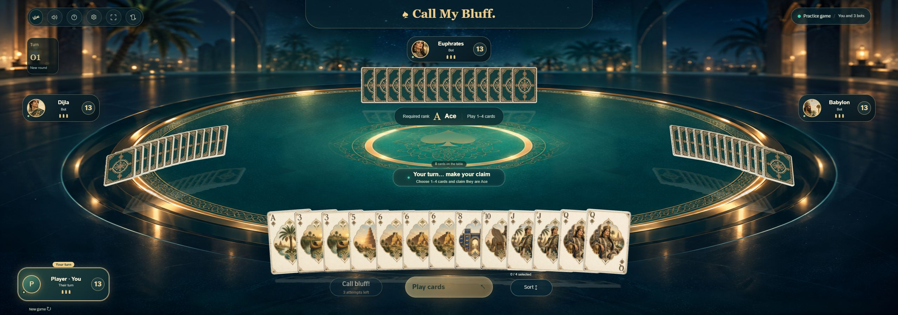
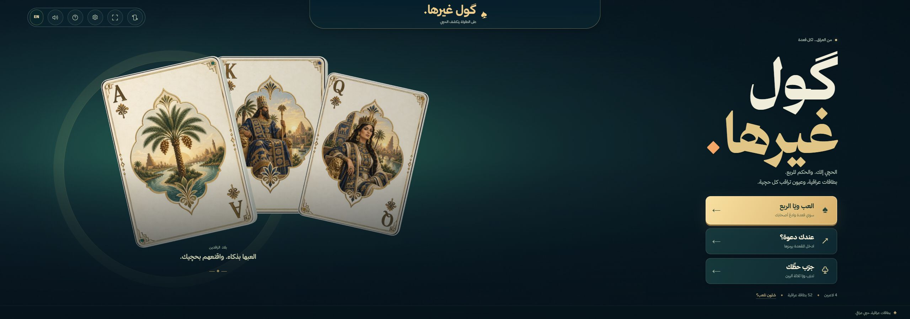

# ⁧گول غيرها⁩

⁧**بطاقات عراقية، حچي عراقي.**⁩

[**⁧▶ العب الآن⁩**](https://gol-ghairha.onrender.com) · [English](README.md)

⁧لعبة ورق وخداع لأربعة لاعبين، بطاولة زمردية وذهبية وبطاقات مستوحاة من العراق. العب مع أصدقائك عبر الإنترنت أو تدرّب ضد ثلاثة لاعبين آليين، مباشرة من المتصفح.⁩

## ⁧عن اللعبة⁩

- ⁧**العب مع أصدقائك:** أنشئ قعدة وشارك دعوتها، أو انضم باستخدام رمز القعدة.⁩
- ⁧**تدرّب وحدك:** واجه ثلاثة لاعبين آليين دون الحاجة إلى حساب.⁩
- ⁧**العربية والإنكليزية:** بدّل اللغة من الزر الموجود داخل اللعبة.⁩
- ⁧**للحاسوب والهاتف:** طاولة تتكيف مع الشاشة، مع حركة للبطاقات ومؤثرات صوتية.⁩

## ⁧طريقة اللعب⁩

1. ⁧افتح [اللعبة](https://gol-ghairha.onrender.com)، اختر اسمًا مستعارًا، ثم ابدأ قعدة أو مباراة تدريب.⁩
2. ⁧نزّل من بطاقة إلى أربع بطاقات مقلوبة، وادّعِ أنها تطابق الرتبة المطلوبة، بالتدرج من الآس إلى الملك.⁩
3. ⁧اعترض إذا شككت بالحچي. إذا انكشف الكذب يأخذ صاحبه كومة البطاقات، وإذا كان الاعتراض خاطئًا يأخذها المعترض. تخلّص من أوراقك واجتز الاعتراض الأخير لتفوز.⁩

## ⁧القائمة الرئيسية⁩

⁧**لا تحتاج إلى تثبيت.** اللعبة مستضافة على ⁦Render⁩؛ قد تستغرق الزيارة الأولى بعد فترة خمول وقتًا أطول قليلًا للتحميل.⁩
